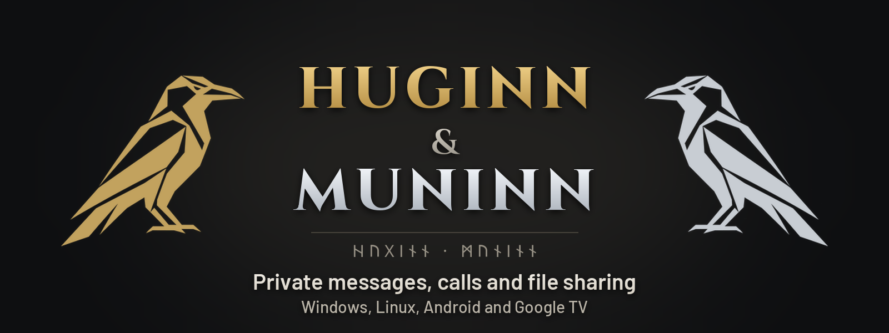
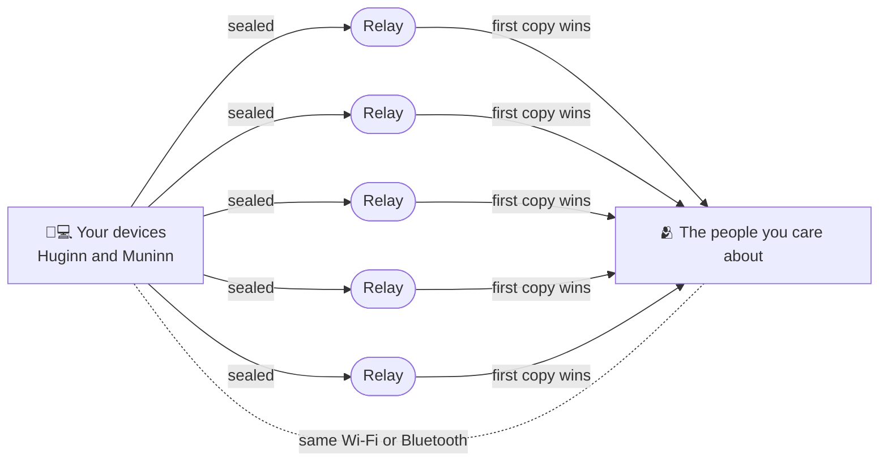

<p align="center"></p>

<h1 align="center">Anti-deplatforming.<br>Secure communication.</h1>

<h3 align="center">For you and the ones you care about.</h3>

<p align="center">
<b>Huginn</b> is the desktop app: a portable zip for Windows and a Flatpak for Linux.<br>
<b>Muninn</b> is the Android app: phones and tablets, plus Kids' TV on Google TV.
</p>

<p align="center">
<a href="https://github.com/Ravenor907/Huginn-Muninn/releases/latest"></a>

<a href="../LICENSE"></a>
</p>

<p align="center">
<a href="https://github.com/Ravenor907/Huginn-Muninn/releases/latest/download/Huginn-Windows.zip"><b>Windows</b></a>
&nbsp;&nbsp;·&nbsp;&nbsp;
<a href="https://github.com/Ravenor907/Huginn-Muninn/releases/latest/download/Huginn.flatpak"><b>Linux (Flatpak)</b></a>
&nbsp;&nbsp;·&nbsp;&nbsp;
<a href="https://github.com/Ravenor907/Huginn-Muninn/releases/latest/download/Muninn.apk"><b>Android (APK)</b></a>
</p>

<br>

## What's inside

<table>
<tr>
<td width="33%" valign="top">

### 💬 Chats
Messages, photos, albums, voice and video messages, polls, replies and reactions, sealed end to end.

</td>
<td width="33%" valign="top">

### 🛡️ Groups: Folk and Family
Up to 50 people with channels. Folk keeps 7 days and allows invite links; Family keeps up to 30 and admins add people.

</td>
<td width="33%" valign="top">

### 📞 Calls and voice rooms
Voice and video calls, group video for up to 4, and drop-in voice rooms for up to 8.

</td>
</tr>
<tr>
<td valign="top">

### 🖥️ Screen share
Share your Windows screen in a voice room; everyone in it can watch, on a phone or a computer.

</td>
<td valign="top">

### 📁 Files
Straight between devices on the same Wi-Fi or over the internet, with pause, resume and a reason when it can't go.

</td>
<td valign="top">

### 🔗 Linked PC
Link Huginn to your phone and use your chats from the computer, while every message still goes through the phone.

</td>
</tr>
<tr>
<td valign="top">

### 📺 Kids' TV
A Google TV mode where kids reach only the people their parents allow, set up from the parents' phones.

</td>
<td valign="top">

### 💾 Backups
One file, encrypted with your password, that restores on a phone or a computer.

</td>
<td valign="top">

### 🎨 Look
Dark (stone, iron and aged gold), true Black for OLED, or Light, with accent colors and seasonal Autumn and Snow.

</td>
</tr>
<tr>
<td valign="top">

### 👁️ Accessibility
Color vision modes for red, green or blue weak sight, plus high contrast and larger text.

</td>
<td valign="top">

### 🎮 Controller and handheld
Every action works from a controller, on Linux handhelds in game mode, TV boxes and desktops. [Button guide](../code/shared/docs/controller.md).

</td>
<td valign="top">

### 📡 No internet needed nearby
On the same Wi-Fi or over Bluetooth, messages go device to device with no internet at all.

</td>
</tr>
</table>

<br>

## Why anti-deplatforming

There is no account to close and no service that can shut you out.

- **No account, phone number or email.** Setup makes a key on your device. That key is your identity, and only you hold it.
- **No central server that can ban you.** There is no company server in the middle that stores your contacts or decides who may talk.
- **Many independent relays.** Over the internet, each message is sealed and published to several independent public Nostr relays at once (five by default). The other side keeps the first copy that arrives, so one relay going down, or turning you away, doesn't matter.
- **Direct when close.** On the same Wi-Fi or over Bluetooth, devices talk to each other with no internet and no relay.
- **Cloudflare, plainly.** The project runs a free relay Worker on Cloudflare that hands out short-lived logins for Cloudflare's call relay, used for internet calls when a direct path isn't possible. Messages never go through it, and you can turn internet calls off.



<p align="center"><i>Relays only pass along sealed envelopes they can't read. Nothing in the middle can ban you.</i></p>

<br>

## Secure communication

- **End to end, per message and per recipient.** Each contact has their own ratchet, so every message gets a fresh key. In groups each message is sealed separately to each member: there is no group key to leak or resend.
- **Forward secrecy with day keys.** Relay envelopes are also sealed to a short-lived day key that the recipient deletes, so a key stolen later can't open old traffic.
- **Signed group control.** A group's members, roles and rules are a snapshot signed by an admin. Changes that aren't signed by an admin are refused.
- **Password-encrypted backups.** scrypt and AES-256-GCM. There has never been an unencrypted backup.
- **App lock.** A pattern or a password locks everything the app keeps, with a panic lock to close it at once.
- **Nothing held outside the app.** Keys and chats live in the app's own encrypted vault on your device, never in an OS key store or an outside service.
- **IP addresses are never shown.** Neither app ever puts an IP address on screen.
- **Safety codes checked in person.** A 6-digit code and 4 emoji per contact. Same on both screens means nobody is in between.

<details>
<summary><b>Deep security notes</b></summary>

<br>

- **Identity.** Each device has a P-256 key pair. It seals and signs (ECDSA). Contact codes carry its public half.
- **Ratchet.** Pairwise sealing uses a message ratchet per contact. Call signals and file offers go through it too.
- **Day keys.** Each device makes a new day key every day and deletes each one after 40 days. Senders use one only while it is at most 7 days old. See [protocol.md section 23](../code/shared/docs/protocol.md).
- **Groups.** Every group change is a whole new signed state with a higher version. Members keep the current state and refuse anything not signed by an admin ([section 3](../code/shared/docs/protocol.md)).
- **Relay envelopes.** Padded, sent with a blurred time, and set to expire. Relays see that a mailbox got an event, not who sent it or what it says ([section 20](../code/shared/docs/protocol.md)).
- **Messages don't stay forever.** Every chat has a limit: 7 days, or up to 30 for Family groups and people in each other's Family or Work folder. Older messages are deleted on every device.
- **Calls.** Media is encrypted end to end. The person you call never learns your IP address, except someone you both trust, so the call can go straight between you.
- **Nearby off.** One switch hides the device from people nearby: no announcements on Wi-Fi, no Bluetooth advertising.
- **Backups.** scrypt (N = 65536, r = 8, p = 2) and AES-256-GCM, the header bound to the data. The password is at least 12 characters and can't be reset. See [backup.md](../code/shared/docs/backup.md).
- **Updates.** Every download is signed with the project's own Ed25519 key, and its version is signed too, so an older file can't be passed off as newer. See [releases.md](../code/shared/docs/releases.md).
- **Huginn.exe** is built with Control Flow Guard, CET shadow stacks, ASLR and DEP, and the build fails if any is missing.

**What leaves your device**

- Sealed messages to public Nostr relays.
- Calls: straight over the same Wi-Fi or Bluetooth, straight between people who trust each other, or otherwise through Cloudflare's call relay (TURN). The relay carries encrypted media it can't decode, and it sees your public address. The login for it comes from the project's free relay Worker on Cloudflare, which sees your address, a hash of a random id and the time. Turn off **Internet calls** and calls use only Wi-Fi and Bluetooth. See [relay.md](../code/shared/docs/relay.md).
- STUN lookups to Cloudflare's STUN server to find a direct path: one for each file sent straight, and a few in each call with a trusted contact.
- Update checks to GitHub (can be turned off).
- Labs bug reports, only when a tester sends one: sealed to the project's key alone, with the app version, system and device model.

</details>

<br>

## Download

| App | Download | How |
| --- | --- | --- |
| **Huginn** for Windows | [Huginn-Windows.zip](https://github.com/Ravenor907/Huginn-Muninn/releases/latest/download/Huginn-Windows.zip) | Unzip anywhere and run Huginn.exe. Nothing to install. |
| **Huginn** for Linux | [Huginn.flatpak](https://github.com/Ravenor907/Huginn-Muninn/releases/latest/download/Huginn.flatpak) | Open it to install, or use the command below. |
| **Muninn** for Android and Google TV | [Muninn.apk](https://github.com/Ravenor907/Huginn-Muninn/releases/latest/download/Muninn.apk) | Open it on the device and install it. |

```
cd ~/Downloads && curl -LO https://github.com/Ravenor907/Huginn-Muninn/releases/latest/download/Huginn.flatpak && flatpak install --user -y Huginn.flatpak
```

**Updates are built in.** Both apps check GitHub for a new release, download it, and check its signatures against the project key before anything is installed. A file that doesn't match is refused. Huginn then waits for you to press **Restart now**; Muninn waits for you to tap **Install**. Automatic checks can be turned off.

**Windows SmartScreen.** Huginn.exe has no paid code-signing certificate, so the first time Windows may say "Windows protected your PC". Choose **More info**, then **Run anyway**. Everything Huginn keeps is in the `data` folder beside Huginn.exe: keep it when you update by hand.

**Android.** If Play Protect says it doesn't know the app, tap **More details**, then **Install anyway**.

Want to check a download yourself? [releases.md](../code/shared/docs/releases.md) shows how, with OpenSSL or the GitHub CLI.

<br>

## Privacy at a glance

| Huginn and Muninn never... | |
| --- | --- |
| ask for a phone number, email or account | ✅ |
| show ads or carry trackers | ✅ |
| use Google Play services or Firebase | ✅ |
| keep your keys in an OS key store or an outside service | ✅ |
| show anyone's IP address on screen | ✅ |
| keep messages forever (7 days, at most 30) | ✅ |
| install an update that isn't signed by the project | ✅ |

<br>

## FAQ

<details>
<summary><b>No server? How does a message get there?</b></summary>

<br>

Over the internet, your app seals the message for the person it's for and publishes it to several public Nostr relays at the same time. Their app picks it up from whichever relay it reaches first. The relays can't read it. On the same Wi-Fi or over Bluetooth, it goes straight from one device to the other.

</details>

<details>
<summary><b>What if a relay is shut down?</b></summary>

<br>

Nothing changes for you. Every message goes to all the relays at once, so the others still carry it. Until it is delivered, your app keeps sending it again for a day.

</details>

<details>
<summary><b>Is it free?</b></summary>

<br>

Yes. Both apps are free and open source under GPL-3.0, with no ads and nothing to pay for.

</details>

<details>
<summary><b>How do I add someone?</b></summary>

<br>

Tap **+**, then **Add someone**. Face to face, scan their QR code with Muninn; from afar, paste the code or link they sent you. A shared link opens a page that helps them install the app if they don't have it yet. Then check your safety code together in person.

</details>

<br>

## Security

Found a problem? Report it privately: [SECURITY.md](SECURITY.md).

## Build

Huginn: CMake, Qt 6.10, vcpkg (Windows) or `flatpak-builder` with `code/huginn/packaging/io.github.ravenor907.Huginn.json` (Linux).  
Muninn: Gradle, from `code/muninn/`.  
Protocol: [protocol.md](../code/shared/docs/protocol.md).

## License

GPL-3.0. Fonts: Cinzel, Barlow and Noto Sans Runic (SIL Open Font License).

<br>

<p align="center"><br><i>Two ravens. Your contacts. Your conversations. Your way.</i></p>
